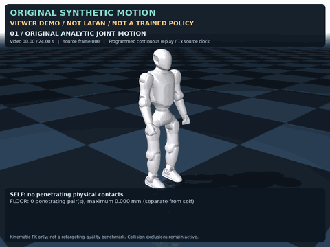
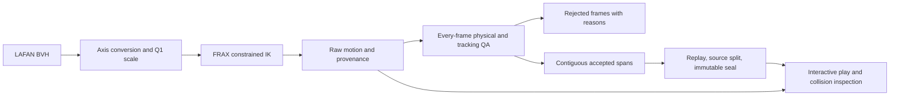

# Q1 FRAX

Reproducible LAFAN1 motion retargeting for the **22-joint Primebot Q1**, using
[Stanford FRAX](https://github.com/StanfordASL/frax). Includes interactive motion
playback, actual MuJoCo collision inspection, and explicit frame-level quality
gates. This is an independent adapter, not an official Primebot or Stanford release.

The output is a **kinematic reference motion**, not a learned policy or a proof
that a physical robot can execute it. No SuperMimic, PyTorch, Isaac Lab or GPU is
required for CPU retargeting and reference playback.

## Video

[](docs/assets/original_q1_demo.mp4)

**[Watch the 24-second MP4](docs/assets/original_q1_demo.mp4)** — original synthetic
joint motion, slow replay, single-frame inspection and an injected collision
test. This demonstrates the viewer; it is not LAFAN retargeting quality evidence
or a trained walking policy. Frame scheduling is programmed, not a recording of
keyboard input. [Source, generator and media hashes](docs/assets/demo.json).

## What is included

- Q1 joint order, physical joint limits, body mapping and contact-aware foot targets.
- Batched FRAX IK with configurable floor and self-collision constraints.
- Real-time reference play with pause, frame inspection, speed control, link names
  and collision markers; offscreen images and video export.
- Physical geometry checks in addition to FRAX's approximate collision spheres.
- Per-frame rejection reasons, contiguous accepted spans, source-clip train/eval
  separation, checksums and immutable dataset sealing.
- Unit tests, a CPU CI workflow, pinned upstream revisions and source-only releases.



## Install

Linux and Python 3.12 are the primary tested environment. Python 3.11 or later is
declared supported; use the tested environment lock for reproducible benchmarks.
Install into a fresh virtual environment:

```bash
git clone https://github.com/ChRis98Wang/frax-q1.git
cd frax-q1
python3.12 -m venv .venv
.venv/bin/python -m pip install -e '.[retarget,visualization,test]'
export PATH="$PWD/.venv/bin:$PATH"
export Q1_FRAX_DATA="$PWD/.local-data"
q1-frax-setup --help
q1-frax-retarget --help
q1-frax-play --help
```

For the tested Python 3.12 dependency versions, add `-c requirements-lock.txt`
to the pip install command. Playback alone only needs `.[visualization]`;
JAX and FRAX are optional until retargeting or source-target replay is requested.

For NVIDIA GPU retargeting on Linux, install the additional CUDA extra:

```bash
.venv/bin/python -m pip install -c requirements-lock.txt -e '.[retarget,cuda13,visualization,test]'
q1-frax-retarget --platform cuda --pattern 'walk2_subject3.bvh' \
  --max-frames 1200 --out outputs/gpu-walk
```

CUDA 13 requires a compatible NVIDIA driver; see the
[official JAX installation guide](https://docs.jax.dev/en/latest/installation.html).
`--platform cpu` is the default. `--devices` selects virtual **CPU** devices and
is rejected for CUDA. A requested GPU backend fails explicitly if unavailable;
it never silently reports CPU work as GPU work.

The data directory defaults to `~/.cache/q1-frax`; it is separate from installed
code. Setup retrieves pinned upstream assets. LAFAN is an explicit opt-in download:

```bash
q1-frax-setup --with-lafan
```

Review [upstream licenses](THIRD_PARTY_NOTICES.md) before downloading or sharing
data. The source distribution contains no robot meshes, LAFAN motions, generated
datasets, learned weights, or LAFAN-derived media. The viewer demo uses original
synthetic joint motion and identifies its source explicitly.

## Retarget, inspect, accept

Start with a short clip before processing the complete corpus:

```bash
q1-frax-retarget --pattern 'walk2_subject3.bvh' --max-frames 300 \
  --devices 1 --out outputs/walk-smoke
```

Use `--max-frames 1200` for a longer first walking check; a short clip may contain
only calibration or fail to provide a full three-second accepted span. Settings
are explicit in [retarget_default.json](configs/retarget_default.json).
The [collision review preset](configs/retarget_collision_review.json) requests
extra clearance; it is an experimental comparison, not a certified improvement.

Raw output and accepted data have different meanings. A completed solve is not a
quality pass. Inspect actual link collisions, review the report and rejection
reasons, and seal only verified contiguous spans. Use each command's `--help` for
the installed CLI schema:

```bash
q1-frax-play outputs/walk-smoke/npz/walk2_subject3.npz --show-link-labels
q1-frax-render outputs/walk-smoke/npz/walk2_subject3.npz artifacts/reference.mp4
q1-frax-play outputs/walk-smoke/npz/walk2_subject3.npz --check-only \
  --collision-report artifacts/collisions.json
# Process enough source clips to populate both splits before sealing.
q1-frax-retarget --pattern 'walk*.bvh' --devices 4 --out outputs/walking
q1-frax-seal --dataset outputs/walking --held-out walk1_subject2 walk2_subject4
q1-frax-seal --dataset outputs/walking --verify-only
```

Play controls: **P / Space** pause, **Left / Right** step one frame,
**+ / -** change speed, **R** restart, **C** collision geometry,
**L** link labels, **M** self-collision highlights.

See the [Python API](docs/API.md), [data format](docs/DATA_FORMAT.md),
[quality standards](docs/QUALITY.md), [collision semantics](docs/COLLISIONS.md),
the [benchmark protocol](docs/BENCHMARKING.md), and the
[Chinese quick start](docs/QUICKSTART.zh-CN.md). Playback never hides bad
frames by labeling a raw archive as accepted data. Kinematic playback assigns
poses and computes geometry; it does not step dynamics or run a policy.

## Quality evidence

The [CPU smoke timing record](benchmarks/cpu_smoke_20261108.json) measured 2,400
source frames on a Core Ultra 7 270K Plus: **2.250 s for IK including JIT**
(1,067 frames/s), and **4.998 s for the complete CLI including QA and export**
(480 frames/s). This is one short workload, not full-corpus throughput. Matched
RTX 5080 CPU/GPU measurements are being validated and will be added separately;
no GPU speed is inferred from these CPU numbers.

The original local Q1 adaptation processed **77 clips / 496,672 frames at 30 Hz**.
That batch used the CPU backend with eight virtual CPU devices; it was not a GPU run.
That is a raw archive, not an all-pass benchmark. The historical walking profile
selected **130 spans / 37,765 frames** (20.98 minutes), split by entire source clip:

| Split | Spans | Source frames | Duration |
|---|---:|---:|---:|
| Train | 94 | 29,618 | 16.45 min |
| Held out | 36 | 8,147 | 4.53 min |

Only 10 of the 12 walking source clips contributed retained long spans. In the
full raw archive, 23 clips had at least one frame with physical self-penetration
over 2 mm. Those raw failure cases are not accepted training motions. These
numbers describe the predecessor dataset; they do **not** claim that a new
version, machine or parameter profile reproduces the same acceptance rate.

Reports distinguish missing evidence from passing evidence. In particular,
physical collision clearance does not establish source-pose tracking accuracy,
dynamic feasibility, torque feasibility, or real-hardware safety.

## Development

```bash
python -m pytest -q
python tools/check_release.py
```

Asset-dependent integration runs are separate from synthetic unit tests. Record
the exact command, environment, source commits, configuration and model hashes
when reporting results. Do not modify accepted manifests to make changed assets
appear compatible. See [contributing](CONTRIBUTING.md).

## Attribution

FRAX supplies the solver; Primebot's Q1 description supplies geometry and limits;
Primebot GMR supplies the LAFAN correspondence; Ubisoft supplies optional LAFAN1
motions. This adapter originated in a SuperMimic development workspace. Full
notices and data restrictions are in [THIRD_PARTY_NOTICES.md](THIRD_PARTY_NOTICES.md).
Adapter code: [MIT](LICENSE).
