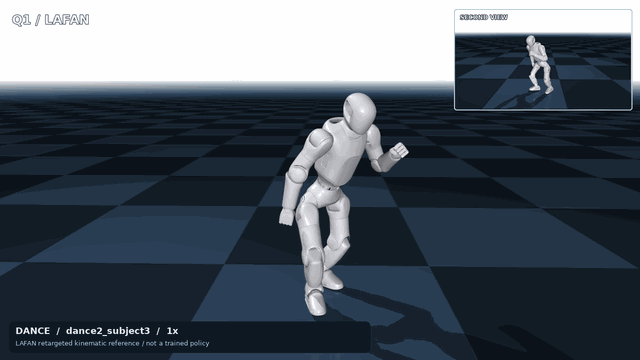
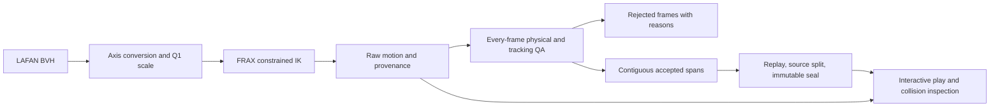

# Q1 FRAX

Reproducible LAFAN1 motion retargeting for the **22-joint Primebot Q1**, using
[Stanford FRAX](https://github.com/StanfordASL/frax). Includes interactive motion
playback, actual MuJoCo collision inspection, and explicit frame-level quality
gates. This is an independent adapter, not an official Primebot or Stanford release.

The output is a **kinematic reference motion**, not a learned policy or a proof
that a physical robot can execute it. No SuperMimic, PyTorch, Isaac Lab or GPU is
required for CPU retargeting and reference playback.

## Video

[](docs/assets/lafan_q1_dynamic.mp4)

**[Watch the 17-second LAFAN motion showcase](docs/assets/lafan_q1_dynamic.mp4)** — real
retargeted motion excerpts at **1× speed / 30 Hz**, with a synchronized second
view. No injected collisions, pose edits, or repeated-frame padding. This is a
kinematic reference, not a trained policy. The excerpts are selected ranges, not
a claim that every frame of the complete source clips passed. The video records
the reviewed 256-row / 3 mm experiment; the release default uses 512 rows.

[Exact source ranges, parameters and hashes](docs/assets/lafan_demo.json) ·
[Independent quality evidence](docs/assets/lafan_quality.json) ·
[Reproduce the video](tools/make_lafan_demo.py).
LAFAN1 motion source: Ubisoft La Forge; [source license and attribution](THIRD_PARTY_NOTICES.md).

## What is included

- Q1 joint order, physical joint limits, body mapping and contact-aware foot targets.
- Batched FRAX IK with configurable floor and self-collision constraints.
- Real-time reference play with pause, frame inspection, speed control, link names
  and collision markers; offscreen images and video export.
- Physical geometry checks, full enabled-pair coverage and self-collision foot volumes.
- Per-frame rejection reasons, contiguous accepted spans, source-clip train/eval
  separation, checksums and immutable dataset sealing.
- Unit tests, a CPU CI workflow, pinned upstream revisions and audited release contents.



## Install

Linux and Python 3.12 are the primary tested environment. Python 3.11 or later is
declared supported; use the tested environment lock for reproducible benchmarks.
Install into a fresh virtual environment:

```bash
git clone https://github.com/ChRis98Wang/frax-q1.git
cd frax-q1
python3.12 -m venv .venv
.venv/bin/python -m pip install -e '.[retarget,visualization,test]'
export PATH="$PWD/.venv/bin:$PATH"
export Q1_FRAX_DATA="$PWD/.local-data"
q1-frax-setup --help
q1-frax-retarget --help
q1-frax-play --help
```

For the tested Python 3.12 dependency versions, add `-c requirements-lock.txt`
to the pip install command. Playback alone only needs `.[visualization]`;
JAX and FRAX are optional until retargeting or source-target replay is requested.

**Retargeting currently runs on CPU.** We verified CUDA 13 and float64 JAX on
an RTX 5080, but the pinned `elastiqp==0.2.1` QP solver only registers its FFI
handler for CPU. A real FRAX CUDA solve fails; installing the `cuda13` extra
alone does not enable GPU retargeting. `--platform cuda` is a diagnostic option
and fails explicitly before creating output when the QP backend is unsupported.
`--devices` selects virtual **CPU** devices, not GPUs.
See the [backend evidence and timing protocol](docs/BENCHMARKING.md).

The data directory defaults to `~/.cache/q1-frax`; it is separate from installed
code. Setup retrieves pinned upstream assets. LAFAN is an explicit opt-in download:

```bash
q1-frax-setup --with-lafan
```

Review [upstream licenses](THIRD_PARTY_NOTICES.md) before downloading or sharing
data. The source distribution contains no robot meshes, source BVH files,
generated motion arrays or learned weights. The explicitly listed README video
and GIF are rendered LAFAN excerpts with source attribution and quality
provenance; they are separate from the MIT adapter-code license.

## Retarget, inspect, accept

Start with a short clip before processing the complete corpus:

```bash
q1-frax-retarget --pattern 'walk2_subject3.bvh' --max-frames 300 \
  --devices 1 --out outputs/walk-smoke
```

Use `--max-frames 1200` for a longer first walking check; a short clip may contain
only calibration or fail to provide a full three-second accepted span. Settings
are explicit in [retarget_default.json](configs/retarget_default.json).
The current default uses a **3 mm additional collision margin and 512 constraint
rows**. The [128-row review preset](configs/retarget_collision_review.json) is a
historical experiment; it does not provide the coverage of the current default.
[Measured 64/128/256/512-row comparison](benchmarks/collision_active_rows_20261108.json).

Raw output and accepted data have different meanings. A completed solve is not a
quality pass. Inspect actual link collisions, review the report and rejection
reasons, and seal only verified contiguous spans. Use each command's `--help` for
the installed CLI schema:

```bash
q1-frax-play outputs/walk-smoke/npz/walk2_subject3.npz --show-link-labels
q1-frax-render outputs/walk-smoke/npz/walk2_subject3.npz artifacts/reference.mp4
q1-frax-play outputs/walk-smoke/npz/walk2_subject3.npz --check-only \
  --collision-report artifacts/collisions.json
# Process enough source clips to populate both splits before sealing.
q1-frax-retarget --pattern 'walk*.bvh' --devices 4 --out outputs/walking
q1-frax-seal --dataset outputs/walking --held-out walk1_subject2 walk2_subject4
q1-frax-seal --dataset outputs/walking --verify-only
```

Play controls: **P / Space** pause, **Left / Right** step one frame,
**+ / -** change speed, **R** restart, **C** collision geometry,
**L** link labels, **M** self-collision highlights.

See the [Python API](docs/API.md), [data format](docs/DATA_FORMAT.md),
[quality standards](docs/QUALITY.md), [collision semantics](docs/COLLISIONS.md),
the [collision audit](docs/COLLISION_AUDIT.md),
the [benchmark protocol](docs/BENCHMARKING.md), and the
[Chinese quick start](docs/QUICKSTART.zh-CN.md). Playback never hides bad
frames by labeling a raw archive as accepted data. Kinematic playback assigns
poses and computes geometry; it does not step dynamics or run a policy.

## Quality evidence

The **0.1.1 default** (full physical pair coverage, foot self-collision volumes,
512 rows, 3 mm extra margin) was rerun on **all 77 clips / 496,672 frames at 30 Hz**.
The [complete run report](benchmarks/full_lafan_v3_20261108.json) records:

| CPU: Core Ultra 7 270K Plus, 8 virtual devices | Time | Throughput |
|---|---:|---:|
| BVH loading | 18.5 s | — |
| IK including cold compilation | 59.24 s (8.14 s JIT) | 8,384 frames/s |
| Full CLI including loading, IK, every-frame QA and export | **148.06 s (2 min 28 s)** | **3,354 frames/s** |

This was an actual batch on a shared workstation with some test/render overlap,
not an isolated or repeated hardware benchmark. It excludes downloading,
installation, sealing and video rendering. **GPU retargeting remains unsupported
by the pinned ElastiQP CUDA backend; no GPU FPS is claimed.**

Every original 30 Hz frame was checked: **0 physical self-penetration frames**.
The raw archive still has 19 floor-penetration frames (maximum 5.692 mm) and 156
frames with negative conservative sphere separation. These failures remain
visible and are not an all-quality pass. The current walking filter retained
50 candidate spans / 8,480 frames; this new archive is not yet split or sealed.
The README excerpts have separate stricter, interpolated-pose and source checks.

Earlier measurements below use the historical collision model/configuration and
must not be quoted as the performance of the current stricter default.

The [matched backend test](benchmarks/gpu_cpu_comparison_20261108.json) uses
2,400 source frames on a Core Ultra 7 270K Plus, float64 and unchanged collision
settings. This is a short workload, not full-corpus throughput. The RTX 5080
passes the CUDA/JAX device test but cannot complete FRAX IK with the pinned
CPU-only QP backend, so **GPU retargeting FPS is unavailable**.

| Hardware / backend | First IK call, including JIT | Warm IK, 3-run median | Full CLI, including QA/export |
|---|---:|---:|---:|
| Core Ultra 7 270K Plus / CPU, 1 virtual device | 2.279 s / 1,053 fps | 0.885 s / 2,712 fps | 4.973 s / 483 fps |
| RTX 5080 / CUDA 13 | Unsupported QP backend | No valid FPS | Did not complete |

JAX device availability is not evidence that the complete IK solver runs on GPU.
The timings above precede the collision-coverage revision; see the recorded
adapter/configuration hashes. An [earlier CPU smoke run](benchmarks/cpu_smoke_20261108.json)
is retained separately, not mixed into the three-run warm measurement.

The original local Q1 adaptation processed **77 clips / 496,672 frames at 30 Hz**.
That batch used the CPU backend with eight virtual CPU devices; it was not a GPU run.
Its original log recorded **18.3 s for BVH loading** and **14.000 s for IK,
including 8.044 s compilation**. Loading plus IK was approximately 32.3 s.
The log-file creation-to-final-write interval was **72.862 s (approximately
73 s end to end)**, consistent with the recorded 39.936 s QA/export phase.
This is a filesystem-timestamp approximation, not a dedicated process timer;
14 s is only IK. These historical settings predate the collision-coverage fix.
[Historical timing and provenance](benchmarks/predecessor_summary.json).
That is a raw archive, not an all-pass benchmark. The historical walking profile
selected **130 spans / 37,765 frames** (20.98 minutes), split by entire source clip:

| Split | Spans | Source frames | Duration |
|---|---:|---:|---:|
| Train | 94 | 29,618 | 16.45 min |
| Held out | 36 | 8,147 | 4.53 min |

Only 10 of the 12 walking source clips contributed retained long spans. In the
full raw archive, 23 clips had at least one frame with physical self-penetration
over 2 mm. Those raw failure cases are not accepted training motions. These
numbers describe the predecessor dataset; they do **not** claim that a new
version, machine or parameter profile reproduces the same acceptance rate.

With the revised foot-volume model and 512-row/3 mm setting, a complete
**21,240-frame dance/jump/run comparison** had zero measured physical
self-penetration at the original source frames. This is a geometry result, not
an all-metric pass; sphere, tracking, slip and interpolated-pose checks remain
separate. The full 77-clip timing above describes the historical configuration.

Reports distinguish missing evidence from passing evidence. In particular,
physical collision clearance does not establish source-pose tracking accuracy,
dynamic feasibility, torque feasibility, or real-hardware safety.

## Development

```bash
python -m pytest -q
python tools/check_release.py
```

Asset-dependent integration runs are separate from synthetic unit tests. Record
the exact command, environment, source commits, configuration and model hashes
when reporting results. Do not modify accepted manifests to make changed assets
appear compatible. See [contributing](CONTRIBUTING.md).

## Attribution

FRAX supplies the solver; Primebot's Q1 description supplies geometry and limits;
Primebot GMR supplies the LAFAN correspondence; Ubisoft supplies optional LAFAN1
motions. This adapter originated in a SuperMimic development workspace. Full
notices and data restrictions are in [THIRD_PARTY_NOTICES.md](THIRD_PARTY_NOTICES.md).
Adapter code: [MIT](LICENSE).
